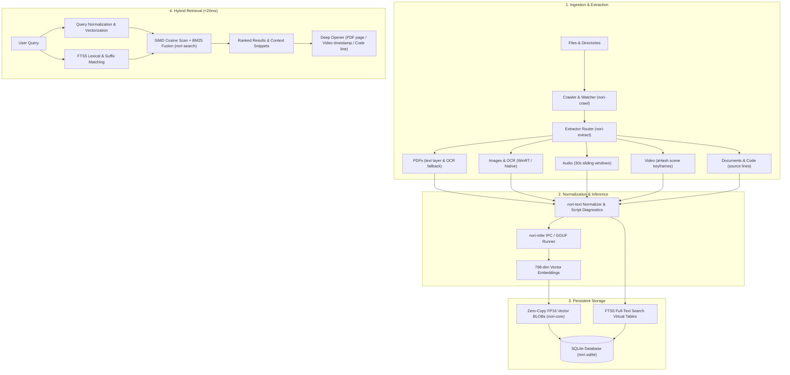

# Nori

<p align="center"><b>Describe it. Dig it up.</b><br>
Search the files on your computer by what's in them, with Google DeepMind's
<a href="https://huggingface.co/google/embeddinggemma-2">EmbeddingGemma 2</a>.<br>
<sub>Free and open source. 100% local. Written in Rust. Everything runs on your computer.</sub></p>

---

EmbeddingGemma 2 is the multimodal embedding model Google DeepMind released in October 2026. It puts text, images,
audio and video into one shared space: a photo of a dog on a beach lands next to the words "a dog on the beach", and a
recording of someone talking about sleep lands next to "where they talk about sleep". It understands more than 100
languages, it's open (Apache 2.0), and at 740M parameters it's small enough to run on a laptop.

**Nori** brings that power directly to your files on Windows, macOS, and Linux. Built from the ground up as a
**high-performance, modular Rust workspace**, Nori indexes your files locally and provides instant, private semantic search
alongside exact keyword retrieval with deep file opener links (jumping straight to PDF pages, video timestamps, or code lines).

Pick the folders to search, and Nori reads the pictures, PDFs, documents, recordings, videos and code projects in them.
Then describe what you're looking for, in your own words, and it finds the match, whatever kind of file it is.

---

## 🏗️ Workspace Architecture & Crates

Nori is engineered as a clean, modular Rust workspace (2024 Edition) partitioned into focused, independently testable crates:

```text
nori/
├── Cargo.toml                       # Workspace manifest (Rust 2024 Edition)
├── README.md                        # Documentation & architecture guide
├── crates/
│   ├── nori-core/                   # Domain types, SIMD vector math, model manifests & task prompts
│   ├── nori-text/                   # Unicode normalization (NFKD), script repair, UAX #29 & snippets
│   ├── nori-storage/                # SQLite connection pool, FTS5 virtual tables & FP16 vector BLOBs
│   ├── nori-extract/                # Multi-modal extractors (PDF, OCR, audio, video, docs, code)
│   ├── nori-infer/                  # Model inference orchestrator, JSON-lines IPC protocol & pooling
│   ├── nori-crawl/                  # Filesystem crawler, ignore rules, and change detector
│   ├── nori-search/                 # Hybrid ranking engine (SIMD vector similarity + FTS5 BM25 + RRF)
│   ├── nori-index/                  # Incremental ingestion pipeline & queue synchronization
│   ├── nori-cli/                    # Command-line interface (`nori`) & JSON-lines background daemons
│   └── nori-gui/                    # Native Tauri v2 desktop search shell, tray icon & spotlight panel
├── worker/                          # Python inference worker (MLX / PyTorch / Transformers)
└── scripts/                         # Build, model download, and platform packaging scripts
```

| Crate / Subsystem | Location | Description & Parity Highlights |
|---|---|---|
| **nori-core** | `crates/nori-core` | Core domain entities (`FileKind`, `SegmentKind`, `Modality`, `Candidate`, `FileRecord`), cross-platform data paths (`LOCALAPPDATA`, `XDG`, `Application Support`), GGUF SHA-256 verifier, task prompt formatters (`task: search result`, `code:`), and 8-way SIMD unrolled FP16 dot product scoring. |
| **nori-text** | `crates/nori-text` | Lexical normalization: NFKD decomposition, selective Latin diacritic folding, Bengali glyph order repair (matras/rephs), Arabic lost letter detection, UAX #29 grapheme cluster matching with inflected suffix swallow, and context-preserving snippet extraction. |
| **nori-storage** | `crates/nori-storage` | Embedded SQLite engine (`rusqlite`), database schema migrations (`files`, `segments`), multilingual FTS5 full-text indexing, zero-copy binary BLOB storage for 768-dim FP16 embeddings, and transactional file move/delete cascades. |
| **nori-extract** | `crates/nori-extract` | Multi-format content extractors: memory-bounded PDF parsing (`pdf-extract`), native Windows Media OCR (`WinRT`) with fallback, image EXIF/downscaling, office docs (DOCX, ODT via ZIP extraction), RTF/HTML/TXT, 30s sliding audio windows, video scene keyframing with perceptual aHash deduplication, secret scanning, and dataset quarantine. |
| **nori-infer** | `crates/nori-infer` | Embedder IPC client protocol: bidirectional stdio JSON-lines communication with external workers (Python MLX/PyTorch or `llama.cpp`), image bicubic resizing to 48px multiples, mean pooling, L2 normalization, and deterministic mock embedder for offline testing. |
| **nori-crawl** | `crates/nori-crawl` | High-throughput non-blocking filesystem crawler, folder inclusion/exclusion rules, `.gitignore` awareness, code repository detection, and file modification tracking. |
| **nori-search** | `crates/nori-search` | Hybrid search engine: combines SIMD cosine similarity across 768-dim FP16 vectors with FTS5 lexical BM25 scores, z-score normalization, Reciprocal Rank Fusion (RRF), code definition boosting, and query keyword highlight mapping. |
| **nori-index** | `crates/nori-index` | Background indexing orchestrator coordinating crawler, extractor, infer, and storage pipelines with transactional checkpointing, incremental updates, and live progress accounting. |
| **nori-cli** | `crates/nori-cli` | Full-featured command-line interface (`nori search`, `index`, `estimate`, `status`, `speed`, `download-model`) and background JSON-lines IPC daemons (`search-service`, `index-service`, `worker`). |
| **nori-gui** | `crates/nori-gui` | Native Tauri v2 desktop shell: global spotlight search panel (`Ctrl+Shift+Space` / `Cmd+Shift+Space`), system tray daemon, preview modal, setup wizard, settings window, and deep application openers. |
| **worker** | `worker/` | Python EmbeddingGemma 2 inference daemon (`nori_worker.py`) supporting Apple Silicon (MLX `mlx-vlm`) and CUDA/CPU (PyTorch/Transformers) via line-delimited JSON IPC. |
| **scripts** | `scripts/` | Shell and PowerShell utilities: model weights downloaders (`download-models.ps1`, `download-models.sh`), llama.cpp patches, and packaging scripts (`package-windows.ps1`, `package-linux.sh`). |

---

## 🔍 What you can find

- *"zebra in a video"* opens the clip at the exact moment the zebra shows up
- *"where they talk about sleep"* jumps to that minute of a podcast or recording
- *"the clause about pets in the lease"* displays the specific PDF page
- *"a dog on the beach"* finds the photo, and *"payment declined error"* finds the screenshot
- A search in English can find a note written in Bengali, Arabic, or any of the model's 100+ supported languages, and vice versa
- *"code: retry a failed call with backoff"* finds the implementation in your code repositories

Exact words count too. Invoice numbers, error codes, and identifiers are matched verbatim in file names and document contents through SQLite FTS5, ensuring queries capture both conceptual meaning and exact terms.

---

## 🔒 Private & 100% Local

Nothing you index ever leaves your computer:
- **Zero Cloud:** All embeddings, OCR, text extractions, and vector searches execute locally on your GPU or CPU.
- **No Telemetry & No Accounts:** Nori does not track searches, document contents, or system metrics.
- **Minimal Network Usage:** Nori connects to the network only once to download the model weights (via Hugging Face Hub), with an optional daily update check that can be toggled off in Settings.

---

## 🖥️ Using the Desktop App

Nori sits in your system tray (Windows & Linux) or menu bar (macOS), quietly keeping your index up to date.

| Shortcut (Windows & Linux) | Shortcut (macOS) | Action |
|---|---|---|
| **Ctrl+Shift+Space** | **⇧⌘Space** | Opens the floating search spotlight panel from any application |
| **↓ ↑** | **↓ ↑** | Moves through ranked search results |
| **Enter** | **↩** | Deep-opens the result: PDFs at the page, audio/video at the moment, code in your editor at the line |
| **Space** | **Space** | Displays a rich pop-out preview (page text, photo, or playing from the timestamp) |
| **Ctrl+Enter** | **⌘↩** | Reveals the file in Explorer, Finder, or your desktop file manager |
| **Ctrl+C** | **⌘C** | Copies the file directly to the clipboard |
| **Ctrl+O** | **⌘O** | Opens the full search window with file kind filters and picture grid |

### Deep Application Opener Integration

- **PDFs:** Opens at the exact matched page in compatible viewers (Edge, Chrome, Firefox, Adobe Acrobat, SumatraPDF, Evince, Okular). On macOS, opens in Preview with search words highlighted.
- **Audio & Video:** Jumps directly to the matched timestamp in VLC, mpv, MPC-HC, QuickTime Player, or IINA.
- **Code:** Opens the exact file and line number in your preferred editor: Zed, VS Code, Cursor, Sublime Text, JetBrains IDEs, Notepad++, or Xcode (configurable in Settings).

---

## 💻 Using the CLI

Nori includes a comprehensive command-line binary (`nori`) built from `crates/nori-cli`:

```sh
# Hybrid meaning (vectors) + keyword (FTS5) search
nori search "machine learning evaluation metrics"

# Search within code repositories
nori search "retry with backoff" --code

# Filter results by file kind (pdf, image, audio, video, doc, code)
nori search "invoice receipt" --kind pdf --limit 5

# Output search results as machine-readable JSON
nori search "quarterly budget" --json

# Synchronize, extract media, and index folders
nori index ~/Documents ~/Pictures

# Estimate file counts, pages, and projected indexing time without writing to disk
nori estimate ~/Projects --code

# Display database health, segment count, and storage size
nori status

# Benchmark local SIMD vector dot-product scoring
nori speed --tries 5

# Download and verify EmbeddingGemma 2 GGUF models
nori download-model
```

---

## ⚙️ How It Works

```
your folders ─► Crawler & Watcher (nori-crawl)
             ─► Multi-modal Extractors (PDF, WinRT OCR, Audio, Video, Docs, Code)
             ─► nori-text Normalizer (NFKD, Latin diacritic folding, script repair)
             ─► EmbeddingGemma 2 (740M Q8_0 GGUF on GPU/CPU via nori-infer)
             ─► SQLite Storage (nori-storage): 768-dim FP16 BLOBs + FTS5 Index

your query   ─► nori-text Normalizer ─► Query Vector + FTS5 Exact Matchers
             ─► nori-search Hybrid Ranking: SIMD Cosine Similarity + BM25 (<20ms)
             ─► Instant Results in Spotlight Panel (nori-gui) or Terminal (nori-cli)
```



---

## 🛠️ Build from Source

### Prerequisites

- **Rust Toolchain:** 2024 Edition (`rustc 1.85+`)
- **C/C++ Build Tools:** Visual Studio C++ Build Tools (Windows), `build-essential` (Linux), or Xcode Command Line Tools (macOS)
- **CMake:** For optional native llama.cpp builds

### Building and Testing

```sh
# Clone the repository
git clone https://github.com/nori/nori.git && cd nori

# Run all unit and integration tests across all 10 workspace crates
cargo test --workspace

# Run tests for specific subsystems
cargo test -p nori-text
cargo test -p nori-core
cargo test -p nori-search
cargo test -p nori-storage

# Build the release CLI binary
cargo build --release -p nori-cli

# Run the desktop application in development mode
cargo run -p nori-gui

# Build release desktop application (via Tauri)
cargo build --release -p nori-gui
```

### Model Setup

Nori uses Google DeepMind's EmbeddingGemma 2 (740M Q8_0 GGUF). You can download and verify the model files automatically:

- **Windows (PowerShell):**
  ```powershell
  powershell -ExecutionPolicy Bypass -File scripts\download-models.ps1
  ```
- **macOS / Linux:**
  ```sh
  chmod +x scripts/download-models.sh
  ./scripts/download-models.sh
  ```
- **Via Nori CLI:**
  ```sh
  nori download-model
  ```

---

## ❓ FAQ

**How is this different from Windows Search or Spotlight?**  
Standard OS search indexes file names, basic metadata, and plain text. Nori understands the *meaning* of what is in your files—photos, spoken audio, video moments, scanned documents, and code—and jumps directly to the matched page or timestamp.

**Why is the model download ~865 MB?**  
The download contains the complete quantized multimodal model: the text encoder and the vision/audio projection weights. The model is downloaded once and stored locally.

**Will it slow down my computer?**  
No. Only the initial indexing pass performs intensive embedding generation. Subsequent runs are purely incremental, indexing newly created or modified files. Ingestion runs at low background process priority, and search queries take less than 20 milliseconds.

**Which languages are supported?**  
EmbeddingGemma 2 supports more than 100 languages. Nori supports cross-lingual search (e.g. search in English to find Arabic or Bengali documents) and includes specialized text normalizers for non-Latin scripts.

**How do I completely remove Nori?**  
- **Windows:** Delete `%LOCALAPPDATA%\Nori` (contains models and SQLite databases).
- **Linux:** Delete `~/.local/share/nori` and `~/.config/nori`.
- **macOS:** Delete `~/Library/Application Support/Nori`.

---

## 🤝 Thanks & Attribution

- Built on [EmbeddingGemma 2](https://huggingface.co/google/embeddinggemma-2) by Google DeepMind (Apache 2.0).
- Compatible with [llama.cpp](https://github.com/ggml-org/llama.cpp) (MIT).
- Desktop search shell powered by [Tauri v2](https://tauri.app/).

*Disclaimer:* Nori is an independent open-source project and is not affiliated with Google, Apple, or Microsoft. Gemma is a trademark of Google LLC; Mac and Spotlight are trademarks of Apple Inc.; Windows is a trademark of Microsoft Corporation.

---

## 📄 License

MIT
