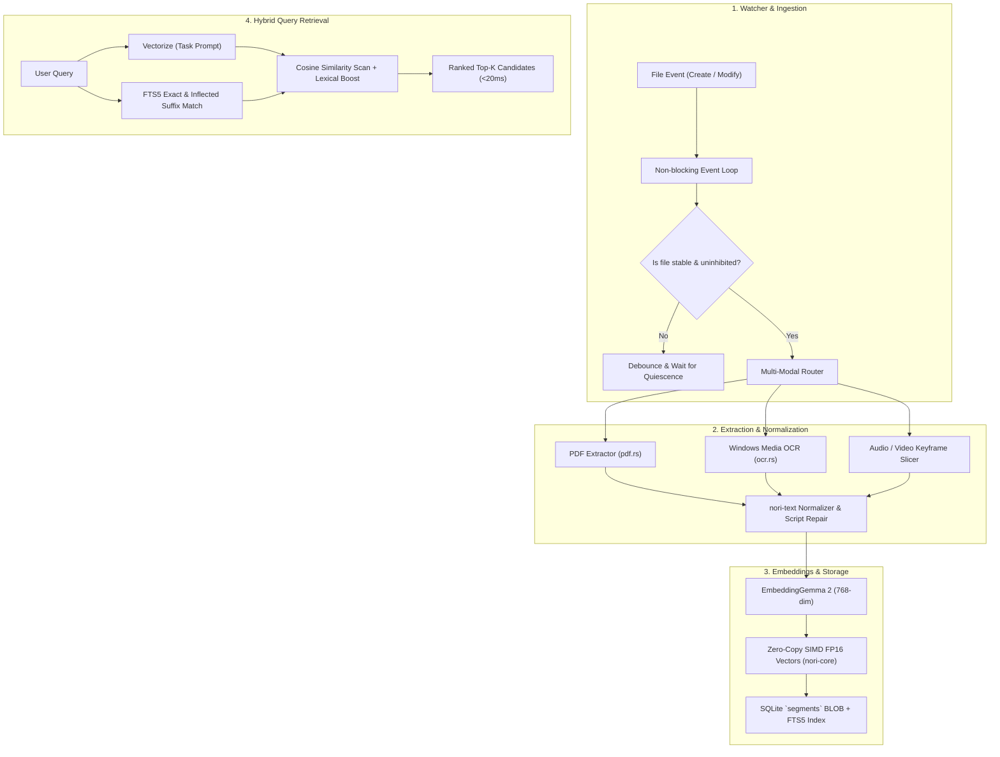

<p align="center"></p>

<h1 align="center">Nori</h1>

<p align="center"><b>Describe it. Dig it up.</b><br>
Zero-cloud, autonomous desktop organizer and multimodal semantic search engine powered by Google DeepMind's
<a href="https://huggingface.co/google/embeddinggemma-2">EmbeddingGemma 2</a>.</p>

<p align="center">
  <a href="#migration-progress-tracker"><b>Migration Tracker</b></a> ·
  <a href="#what-you-can-find"><b>What You Can Find</b></a> ·
  <a href="#architecture--how-it-works"><b>Architecture</b></a> ·
  <a href="#codebase-layout"><b>Codebase</b></a> ·
  <a href="#getting-started"><b>Getting Started</b></a><br>
  <sub>Free and open source. 100% local. Everything runs on your computer.</sub>
</p>

---

[](https://www.rust-lang.org/)
[](https://github.com/ARahim3/nori)
[](#private--zero-cloud-guarantee)
[](LICENSE)

---

## 💡 Overview: From DigUp to Nori

**Nori** is the next-generation, high-performance **Rust rewrite** of [DigUp](https://github.com/ARahim3/DigUp).

EmbeddingGemma 2 is the multimodal embedding model Google DeepMind released in October 2026. It maps text, images, audio, and video into a single shared 768-dimensional vector space: a photo of a dog on a beach lands next to the words *"a dog on the beach"*, and a recording of someone talking about sleep lands next to *"where they talk about sleep"*. It understands over 100 languages, is open (Apache 2.0), and at 740M parameters it is lean enough to run locally on consumer hardware.

### Why rewrite in Rust?
The original DigUp implementation was split across macOS-specific Swift/SwiftUI and a Tauri/C++ wrapper for Windows and Linux, relying on proprietary Apple Foundation APIs (such as `NSString.range(..., options: [.diacriticInsensitive])` and macOS Vision OCR). 

**Nori replaces this entire heterogeneous stack with a modular, memory-safe, pure-Rust workspace:**
- **Zero OS Lock-In:** Pure-Rust Unicode NFKD diacritic folding and UAX #29 grapheme segmentation replace Apple's Foundation framework.
- **Multilingual Script Precision:** Native script health validators and inflection-aware prefix matchers for Indic (Bengali, Hindi) and Arabic scripts.
- **Extreme Performance:** Zero-copy SIMD vector math (FP16 storage with FP32 unrolled dot products), memory-mapped vector caches, and embedded SQLite with FTS5.
- **Autonomous File Management:** Combines semantic search with download-folder debounce, file stabilization, atomic organization, and a 1-click Undo safety ledger.

---

## 🗺️ Migration Progress Tracker

This table tracks the porting of DigUp's Swift/Tauri codebase to the modular Nori Rust workspace.

| Component / Subsystem | Original DigUp (Swift / Tauri) | Nori Rust Implementation | Status | Notes |
|---|---|---|:---:|---|
| **Core Domain & Types** | `Types.swift`, `FileRecord`, `SegmentKind` | `crates/nori-core/src/types.rs` | ✅ Done | Full enum definitions (`FileKind`, `SegmentKind`, `Modality`), `FileRecord`, `SegmentRecord`, `Candidate`. |
| **Model Manifest & Paths** | `ModelFiles.swift`, `AppPaths.swift` | `crates/nori-core/src/media_files.rs` | ✅ Done | Cross-platform paths (`%LOCALAPPDATA%`, `Application Support`, `XDG`), HF Hub cache resolver, streaming SHA-256 verifier. |
| **Prompt Formatters** | `Prompts.swift`, `CodeQuery.swift` | `crates/nori-core/src/prompts.rs` | ✅ Done | DeepMind task prompts (`search result`, `code retrieval`), `code:` query parser. |
| **SIMD Vector Math** | Swift Accelerate / BLAS vDSP | `crates/nori-core/src/vectors.rs` | ✅ Done | 768-dim FP16 conversion (`half`), unrolled 8-way SIMD dot product, mmap scratch block storage. |
| **Lexical Normalization** | `SearchText.swift` (NFKC + diacritics) | `crates/nori-text/src/normalize.rs` | ✅ Done | NFKD + selective Latin diacritic stripping (preserving Indic vowels & nuktas), Arabic alef/tatweel normalization, natural language detector (`has_words`). |
| **Script Repair & Diagnostics** | `PageTextProblem.swift` | `crates/nori-text/src/script.rs` | ✅ Done | Detects reversed Bengali matras/rephs, broken Arabic letter isolation, and abbreviations. |
| **Exact & Inflected Matching** | `SearchText.matches` (.diacriticInsensitive) | `crates/nori-text/src/matches.rs` | ✅ Done | Grapheme-aware cluster boundaries (`unicode-segmentation`), Arabic & Bengali inflected suffix swallow, verbatim byte range mapping. |
| **Keyword Snippet Extractor** | `SearchText.snippet` | `crates/nori-text/src/snippet.rs` | ✅ Done | Highlighting snippets with sentence boundary awareness and match range preservation. |
| **Storage & SQLite Schema** | SQLite3 + `fts5` keyword index | `crates/nori-storage` & `src/db.rs` | 🟡 In Progress | Modularizing schema (`files`, `segments`, `fts_segments`, `transactions`), zero-copy `bytemuck` BLOBs. |
| **Download Quiescence & Watcher** | macOS FSEvents / Tauri notify | `src/watcher.rs`, `src/debounce.rs` | ✅ Done | Multi-sample size stability, temporary extension filtering (`.crdownload`, `.part`), Windows `share_mode(0)` handle verification. |
| **PDF Text Extractor** | PDFKit (Mac) / PDFium (Win/Lin) | `src/extractors/pdf.rs` | 🟡 In Progress | Basic text layer extraction with panic isolation working; scan-to-image pipeline being ported. |
| **OCR (Screenshots & Images)** | Apple Vision framework | `src/extractors/ocr.rs` | 🟡 In Progress | Native Windows `Windows.Media.Ocr` (WinRT) implemented (<50ms, zero-cloud); cross-platform fallback planned. |
| **Audio & Video Windowing** | AVFoundation / FFmpeg | `src/extractors/` | ⚪ Planned | 30s overlapping audio windows and video shot-boundary keyframe extraction. |
| **Model Inference Engine** | `llama.cpp` C++ helper process | `crates/nori-engine` | ⚪ Planned | EmbeddingGemma 2 740M GGUF runner (Metal / Vulkan / CPU via llama-cpp bindings or ONNX). |
| **Desktop Shell & System Tray** | SwiftUI (Mac) / Tauri v1 (Win/Lin) | `crates/nori-app` / Tauri v2 | ⚪ Planned | Global search overlay (`Ctrl+Shift+Space` / `Alt+Space`), result navigation, deep file openers. |

---

## 🔍 What You Can Find

- **"zebra in a video"** opens the clip at the exact moment the zebra appears.
- **"where they talk about sleep"** jumps to that exact minute of a podcast.
- **"the clause about pets in the lease"** shows the PDF page.
- **"a dog on the beach"** finds the photo, and **"payment declined error"** locates the screenshot.
- A search in English can find a note written in Bengali, Arabic, or any of the model's 100+ languages, and vice versa.
- **`code: retry a failed call with backoff`** finds the function in your projects, opening directly at the definition line.

Exact words count too. Invoice numbers, error codes, and names are matched as written in filenames and document text via SQLite FTS5, providing a hybrid score combining semantic vectors with exact lexical boosts.

---

## 🔒 Private & Zero-Cloud Guarantee

Everything you index stays on your machine. Nori makes no outbound network connections during operation, collects no telemetry, and requires no accounts. It connects to the network only if you explicitly permit it to download the EmbeddingGemma 2 weights (865 MB) once upon initial setup.

---

## ⌨️ Shortcuts & Desktop Integration

| macOS | Windows & Linux | Action |
|:---:|:---:|---|
| **⇧⌘Space** | **Ctrl+Shift+Space** | Opens the instant search panel from any app |
| **↓ ↑** | **↓ ↑** | Navigate search results |
| **↩** | **Enter** | Opens result: PDF at the page, audio/video at the moment, code at the line |
| **Space** | **Space** | Quick preview at the matched page or timestamp |
| **⌘↩** | **Ctrl+Enter** | Reveal file in Finder, File Explorer, or file manager |
| **⌘C** | **Ctrl+C** | Copy file to clipboard |
| **⌘O** | **Ctrl+O** | Expand into full workspace window with picture grid and metadata filters |

---

## 📂 What Nori Reads

Only the folders you specify:

- **Pictures & Screenshots:** JPEG, PNG, HEIC, WebP, etc., by visual semantics and on-device OCR.
- **PDFs:** Page by page, including scanned documents. Long documents get the first 30 pages immediately, indexing remaining pages in the background (up to 5,000 pages per file).
- **Documents:** `txt`, `md`, `rtf`, `docx`, `odt`, `html`. Numeric tables and raw CSV dumps are filtered to prevent wasting vector capacity.
- **Audio:** Overlapping 30-second windows with timestamp jumping.
- **Video:** Frame extraction per shot boundary plus audio soundtrack embedding.
- **Code Projects:** Reads source code, notebooks, and markdown docs when code search is enabled. Automatically respects `.gitignore`, skips vendor folders, binaries, and keys/secrets.

---

## 🏗️ Architecture & How It Works

```
your folders ─► Non-blocking Watcher & Quiescence Debounce
             ─► Multi-modal Readers (PDF, OCR, Audio, Video, Code)
             ─► DeepMind EmbeddingGemma 2 (740M Q8_0 GGUF on GPU/CPU)
             ─► SQLite Storage: 768-dim FP16 Vector BLOBs + FTS5 Keyword Index
your query   ─► nori-text Normalizer ─► Query Vector + Exact Matcher ─► Ranked Results (<20ms)
```



---

## 📦 Codebase Layout

```text
nori/
├── Cargo.toml                       # Workspace manifest (Rust 2024 Edition)
├── README.md                        # Documentation & migration roadmap
├── crates/
│   ├── nori-core/                   # Core types, vector math, model manifests
│   │   ├── src/types.rs             # FileKind, SegmentKind, Candidate, Modality
│   │   ├── src/vectors.rs           # 768-dim FP16/FP32 SIMD dot products & mmap storage
│   │   ├── src/prompts.rs           # EmbeddingGemma 2 task prompt formatters
│   │   └── src/media_files.rs       # Cross-platform paths & GGUF SHA-256 verifier
│   ├── nori-text/                   # Unicode normalization, script health, matches
│   │   ├── src/normalize.rs         # NFKD diacritic folding, Indic/Arabic normalization
│   │   ├── src/matches.rs           # Grapheme-aware word boundary & suffix swallow matching
│   │   ├── src/script.rs            # Bengali glyph order & Arabic lost letters detector
│   │   └── src/snippet.rs           # Contextual keyword snippet generator
│   └── nori-storage/                # SQLite connection, FTS5, and vector tables
├── src/                             # Ingestion engine & CLI daemon
│   ├── main.rs                      # CLI entry point (watch, search, organize)
│   ├── watcher.rs                   # Non-blocking filesystem event loop
│   ├── debounce.rs                  # File size stabilization & handle lock checking
│   ├── media.rs                     # Media categorization & file relocation
│   ├── db.rs                        # SQLite database operations & document chunks
│   └── extractors/                  # Multi-modal extraction modules
│       ├── mod.rs                   # Extractor dispatcher
│       ├── pdf.rs                   # Memory-bounded PDF reader
│       └── ocr.rs                   # Native Windows Media OCR engine
```

---

## 🚀 Getting Started

### Prerequisites

- **Rust Toolchain:** Rust compiler supporting the **2024 Edition** (`rustc 1.85+`).
- **C/C++ Build Tools:** Visual Studio C++ Build Tools (Windows) or `build-essential` (Linux) for bundled SQLite compilation.

### Build and Test

1. **Clone the repository:**
   ```powershell
   git clone https://github.com/ARahim3/nori.git
   cd nori
   ```

2. **Run tests across workspace crates:**
   ```powershell
   # Test text normalization and script repair
   cargo test -p nori-text

   # Test core vector SIMD math and model manifest
   cargo test -p nori-core

   # Test full workspace
   cargo test --workspace
   ```

3. **Start the watcher daemon:**
   ```powershell
   cargo run -- watch
   ```

4. **Search files locally:**
   ```powershell
   cargo run -- search "machine learning evaluation metrics"
   ```

---

## ⚖️ License & Attribution

- Nori is licensed under the [MIT License](LICENSE).
- Powered by [EmbeddingGemma 2](https://huggingface.co/google/embeddinggemma-2) by Google DeepMind (Apache 2.0).
- Inspired by and migrating from [DigUp](https://github.com/ARahim3/DigUp).
- *Disclaimer:* Nori is not affiliated with Google, Apple, or Microsoft. Gemma is a trademark of Google LLC; Mac is a trademark of Apple Inc.; Windows is a trademark of Microsoft Corporation.
